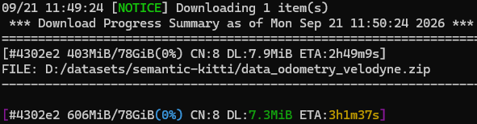

1. aria2 설치
```
winget install aria2.aria2
```
2. 데이터셋 병렬 다운로드 - KITTI 데이터셋 예시
```
aria2c `
  -x 8 `
  -s 8 `
  -k 16M `
  -c `
  --file-allocation=none `
  --retry-wait=5 `
  --max-tries=0 `
  "https://s3.eu-central-1.amazonaws.com/avg-kitti/data_odometry_velodyne.zip"
```



|항목|의미|
|-|-|
|606MiB/78GiB|78GiB 중 606MiB 다운로드|
|CN:8|연결 8개 사용 중|
|DL:10MiB|초당 약 다운로드|
|ETA|남은 시간|
